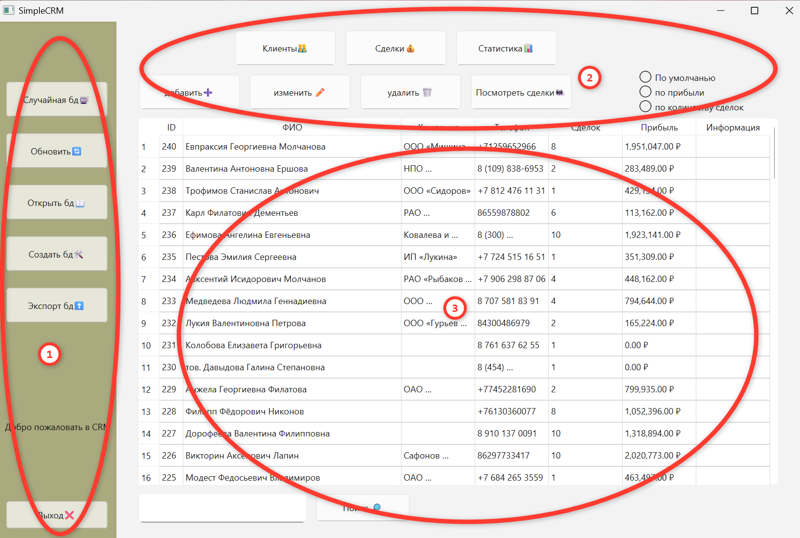
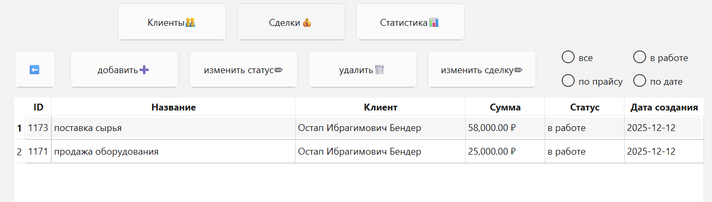
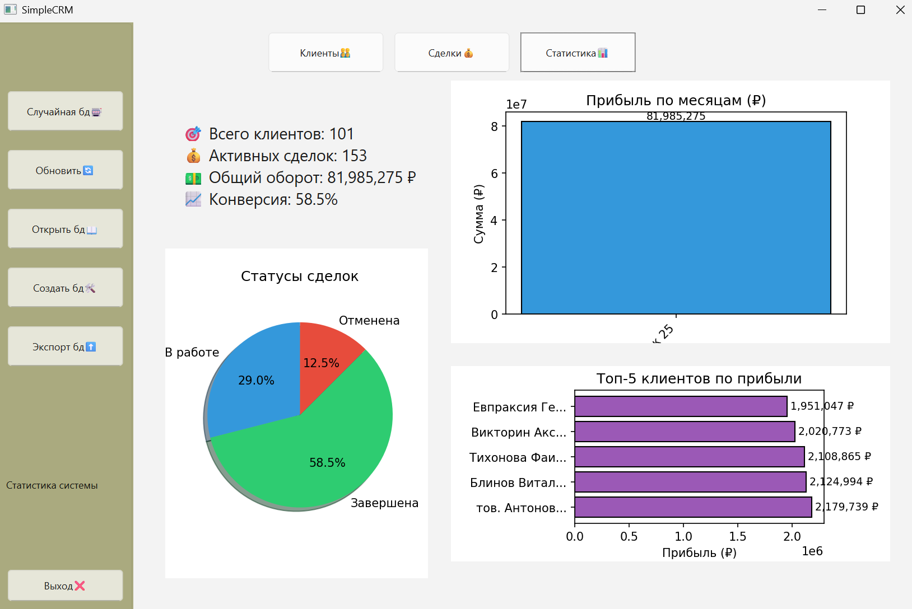

# SimpleCRM

Десктопное CRM-приложение для малого бизнеса: учёт клиентов и сделок, статистика продаж с графиками, экспорт данных. Учебный проект по программированию (Московский политех, 2 семестр, декабрь 2025).

Python · PyQt6 · SQLite · Matplotlib

## Что умеет

**Клиенты**
- добавление, изменение, удаление клиента (при удалении сделки клиента удаляются вместе с ним);
- поиск по клиентам;
- сортировка: по умолчанию, по прибыли, по количеству сделок;
- переход от клиента к списку его сделок.

**Сделки**
- добавление, редактирование и удаление сделок;
- статусы «в работе», «завершена», «отменена»; при смене статуса автоматически пересчитывается прибыль клиента;
- фильтр по статусу, сортировка по цене и дате, поиск.

**Статистика**
- ключевые показатели: число клиентов, активные сделки, общий оборот, конверсия;
- графики: статусы сделок, прибыль по месяцам, топ-5 клиентов по прибыли.

**Работа с базами данных**
- создание новой базы и открытие существующей;
- генерация случайной тестовой базы (библиотека Faker);
- экспорт клиентов и сделок в CSV (UTF-8, разделитель `;`, открывается в Excel).

## Скриншоты

| Клиенты | Сделки |
|---|---|
|  |  |



Красные отметки на первом скриншоте взяты из руководства пользователя: они показывают панель управления, переключатели разделов и таблицу.

## Запуск

Нужен Python 3.8 или новее.

```bash
pip install -r requirements.txt
python main.py
```

Файл `crm_database.db` лежит рядом с программой и открывается при запуске. Внутри только сгенерированные тестовые данные (около 100 клиентов и 500 сделок), реальных людей и компаний там нет. Свою базу можно создать кнопкой «Создать бд», а заполненную случайными данными кнопкой «Случайная бд».

## Структура

```
main.py              окно приложения, обработка кнопок, графики
database.py          класс Database: работа с SQLite, статистика
form.ui              интерфейс, созданный в Qt Designer
crm_database.db      база с тестовыми данными
samples/             пример экспорта клиентов в CSV
docs/screenshots/    скриншоты программы
```

## База данных

Две таблицы:

- `clients`: ФИО, компания, телефон, заметки, дата создания, число сделок, общая прибыль;
- `deals`: клиент (внешний ключ с каскадным удалением), название, описание, сумма, статус (`в работе` / `завершена` / `отменена`), даты создания и закрытия.

## Ограничения

Проект учебный: нет авторизации и разграничения прав, база хранится в локальном файле, а график прибыли по месяцам на тестовых данных показывает один период.
